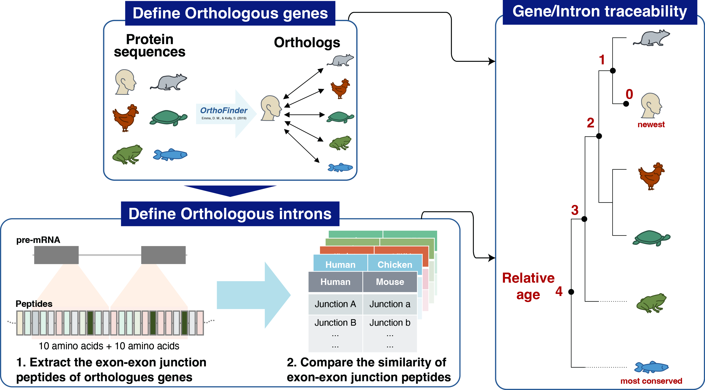

# Orthologous Intron Identification and Evolutionary Age Assignment


This pipeline identifies orthologous introns across six vertebrate species by combining protein-level orthology, transcript annotation, exon-junction peptide matching, and reciprocal best-hit (RBH) searches. Human introns are subsequently assigned an evolutionary age score according to the most distantly related species in which an orthologous intron junction is detected.

## Species

The analysis includes the following six vertebrate species:

| Species | Genome assembly |
|------------------------------------|------------------------------------|
| Human (*Homo sapiens*) | GRCh38 |
| Mouse (*Mus musculus*) | GRCm39 |
| Chicken (*Gallus gallus*) | GRCg7b |
| Western painted turtle (*Chrysemys picta bellii*) | Chrysemys_picta_bellii-3.0.3 |
| Western clawed frog (*Xenopus tropicalis*) | UCB_Xtro_10.0 |
| Zebrafish (*Danio rerio*) | GRCz11 |

## Pipeline overview

``` text
01. OrthoFinder
    Protein-level orthology
          ↓
02. Transcript annotation and junction peptide extraction
    Protein → transcript → CDS intron → exon-junction peptide
          ↓
03. MMseqs2 reciprocal best-hit search
    Cross-species matching of exon-junction peptides
          ↓
04. Orthologous intron matrix construction
    Junction matches → genomic intron coordinates
          ↓
05. Intron evolutionary age assignment
    Human-centered age score from 0 to 4
```

The scripts are organized as:

``` text
scripts/
├── 01_run_orthofinder.sh
├── 02_prepare_junction_peptides.R
├── 03_run_mmseqs2_rbh.sh
├── 04_build_orthologous_intron_matrix.R
└── 05_assign_intron_age.R

functions/
├── process_gtf_introns_with_cds.R
└── JunctionProteinExtraction.R
```

## Requirements

The pipeline requires:

-   OrthoFinder v2.5.5

-   MMseqs2

-   GNU Parallel

-   R

-   Ensembl protein FASTA files

-   Ensembl GTF annotation files

-   R packages:

    -   `dplyr`
    -   `tidyr`
    -   `stringr`
    -   `Biostrings`
    -   `biomaRt`

------------------------------------------------------------------------

# 01. Identify protein-level orthologs with OrthoFinder

Script:

``` text
01_run_orthofinder.sh
```

OrthoFinder is used to establish protein-level orthology among the six vertebrate species.

Input files are Ensembl protein FASTA files for all six species.

Example:

``` bash
bash scripts/01_run_orthofinder.sh /path/to/ensemblProteinSequence
```

Equivalent OrthoFinder command:

``` bash
orthofinder -f ensemblProteinSequence/
```

The downstream analysis uses the human-centered orthologue table generated by OrthoFinder:

``` text
Orthologues/Homo_sapiens.GRCh38.pep.all.tsv
```

This table provides the initial correspondence between human proteins and orthologous proteins in mouse, chicken, turtle, frog, and zebrafish.

------------------------------------------------------------------------

# 02. Map orthologous proteins to transcripts and extract junction peptides

Script:

``` text
02_prepare_junction_peptides.R
```

This step converts the protein-level orthology inferred by OrthoFinder into transcript- and intron-level information.

Run with:

``` bash
Rscript scripts/02_prepare_junction_peptides.R /path/to/orthoFinder
```

The script performs three major operations.

### 2.1 Protein-to-transcript mapping

Ensembl peptide IDs from the OrthoFinder results are converted to:

-   Ensembl transcript IDs
-   Ensembl gene IDs
-   gene names

using `biomaRt`.

The human-centered orthology relationships are then expanded to the corresponding transcripts in each species.

### 2.2 CDS intron annotation

Transcript structures are retrieved from the corresponding Ensembl GTF files using:

``` text
functions/process_gtf_introns_with_cds.R
```

For each orthologous transcript, introns located within protein-coding regions are identified together with their genomic coordinates.

### 2.3 Exon-junction peptide extraction

For every CDS intron, the corresponding exon-exon junction peptide is extracted from the protein sequence using:

``` text
functions/JunctionProteinExtraction.R
```

Each CDS intron is therefore represented by a peptide sequence spanning its corresponding exon junction.

Conceptually:

``` text
Orthologous protein
      ↓
Transcript
      ↓
CDS exon/intron structure
      ↓
Exon-junction peptide
```

Human-species protein pairing tables are also generated for the subsequent MMseqs2 analysis.

### Junction peptide FASTA files

Before Step 3, the extracted junction peptides must be exported as per-protein FASTA files using the scripts in:

``` text
saveJunctionFasta/
```

The expected structure is:

``` text
extractedJunctionPeptides/
├── Human/
├── Mouse/
├── Chicken/
├── Turtle/
├── Frog/
├── Zebrafish/
└── PairedIDTable/
```

Each protein FASTA contains the exon-junction peptides associated with CDS introns from that protein.

------------------------------------------------------------------------

# 03. Identify orthologous junctions using MMseqs2 reciprocal best hits

Script:

``` text
03_run_mmseqs2_rbh.sh
```

Exon-junction peptides from orthologous protein pairs are compared using MMseqs2 `easy-rbh`.

Five human-centered comparisons are performed:

``` text
Human ↔ Mouse
Human ↔ Chicken
Human ↔ Turtle
Human ↔ Frog
Human ↔ Zebrafish
```

Run with:

``` bash
bash scripts/03_run_mmseqs2_rbh.sh /path/to/orthoFinder
```

The core MMseqs2 command is:

``` bash
mmseqs easy-rbh \
    human_junctions.fasta \
    species_junctions.fasta \
    output_RBH.tsv \
    tmp \
    --min-seq-id 0.4 \
    --threads 4
```

A minimum amino-acid sequence identity of 40% is required.

Reciprocal best-hit matching requires that a human exon-junction peptide identifies a junction peptide from the orthologous species as its best match and that the corresponding reverse search identifies the original human junction as the best match.

The resulting RBH pairs are treated as candidate orthologous intron junctions.

Multiple protein pairs are processed in parallel using GNU Parallel.

------------------------------------------------------------------------

# 04. Construct the cross-species orthologous intron matrix

Script:

``` text
04_build_orthologous_intron_matrix.R
```

Run with:

``` bash
Rscript scripts/04_build_orthologous_intron_matrix.R /path/to/orthoFinder
```

This step converts MMseqs2 junction matches back to genomic intron coordinates.

For each exon-junction peptide, an intron identifier is generated as:

``` text
chromosome:start-end:strand
```

and intron length is calculated as:

``` text
intron_end - intron_start + 1
```

For each human-species RBH pair:

``` text
Human junction ID
        ↕
Species junction ID
        ↓
Human genomic intron
        ↕
Species genomic intron
```

The five pairwise datasets are then merged using human introns as the reference.

The resulting matrix has the structure:

``` text
Human   Mouse   Chicken   Turtle   Frog   Zebrafish
```

where each row represents one human intron and its detected orthologous introns across species.

Human introns are restricted to standard GRCh38 chromosomes and introns ≥10 nt.

For the intron-length heatmap, detected introns are represented by:

``` text
log10(intron length)
```

Species without an identified orthologous intron are represented by `0` for visualization.

Specifically:

``` text
missing value → 1 → log10(1) = 0
```

Therefore, a value of `0` in this visualization represents the absence of an identified orthologous intron and should not be interpreted as a biologically observed 1-nt intron.

Primary output:

``` text
filtered_allJoined_heatMap.rds
```

------------------------------------------------------------------------

# 05. Assign intron evolutionary age

Script:

``` text
05_assign_intron_age.R
```

Run with:

``` bash
Rscript scripts/05_assign_intron_age.R /path/to/orthoFinder
```

Human introns are assigned an evolutionary age according to the most distantly related species in which an orthologous intron is detected.

The scoring system is:

| Age score | Conservation pattern  | Interpretation       |
|----------:|-----------------------|----------------------|
|         0 | Human only            | Human-specific       |
|         1 | Mouse                 | Mammalian-conserved  |
|         2 | Chicken and/or turtle | Amniote-conserved    |
|         3 | Frog                  | Tetrapod-conserved   |
|         4 | Zebrafish             | Vertebrate-conserved |

The assignment follows a hierarchical rule based on the most distant detected ortholog.

For example, an intron detected in human, mouse, chicken, frog, and zebrafish is assigned:

``` text
ageScore = 4
```

because zebrafish represents the most distant species included in the analysis.

Likewise, an intron detected in human, mouse, and chicken but not frog or zebrafish is assigned:

``` text
ageScore = 2
```

The final output contains:

``` text
oriIntronID
ageScore
```

and is saved as:

``` text
intronBySpecies_2_ageScore.rds
```

## Interpretation of the age score

The age score is a conservation-based proxy for intron evolutionary age rather than an estimate of absolute evolutionary time.

In downstream analyses, higher scores indicate that an intron junction is detectable across progressively more distantly related vertebrate species:

``` text
younger    ---->   ---->     ---->    older
   0         1        2        3        4
Human     Mouse    Amniote    Frog    Zebrafish
only
```

Accordingly, the evolutionary age of a human intron is defined by the most distantly related species in which a corresponding orthologous intron junction can be identified by this pipeline.

------------------------------------------------------------------------

# Complete workflow

Assuming the required reference files have been prepared:

``` bash
# Step 1: protein-level orthology
bash scripts/01_run_orthofinder.sh /path/to/ensemblProteinSequence

# Step 2: transcript annotation and junction peptide extraction
Rscript scripts/02_prepare_junction_peptides.R /path/to/orthoFinder

# Export junction peptides to per-protein FASTA files
# using scripts in saveJunctionFasta/

# Step 3: reciprocal best-hit junction matching
bash scripts/03_run_mmseqs2_rbh.sh /path/to/orthoFinder

# Step 4: construct orthologous intron matrix
Rscript scripts/04_build_orthologous_intron_matrix.R /path/to/orthoFinder

# Step 5: assign evolutionary age
Rscript scripts/05_assign_intron_age.R /path/to/orthoFinder
```

## Main outputs

``` text
filtered_allJoined_heatMap.rds
```

Cross-species human-centered orthologous intron matrix containing log10-transformed intron lengths.

``` text
intronBySpecies_2_ageScore.rds
```

Human intron evolutionary age assignments used for downstream conservation, intron-length, and nucleotide-composition analyses.
